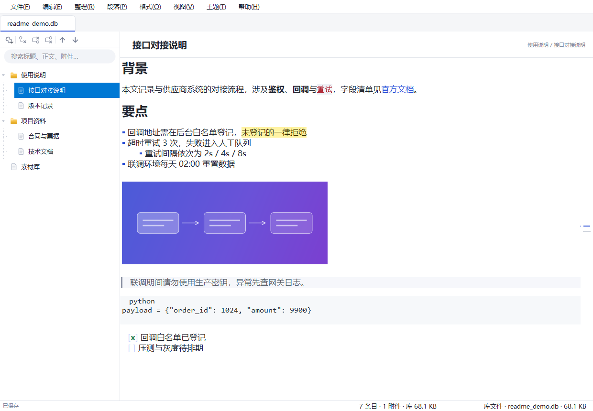
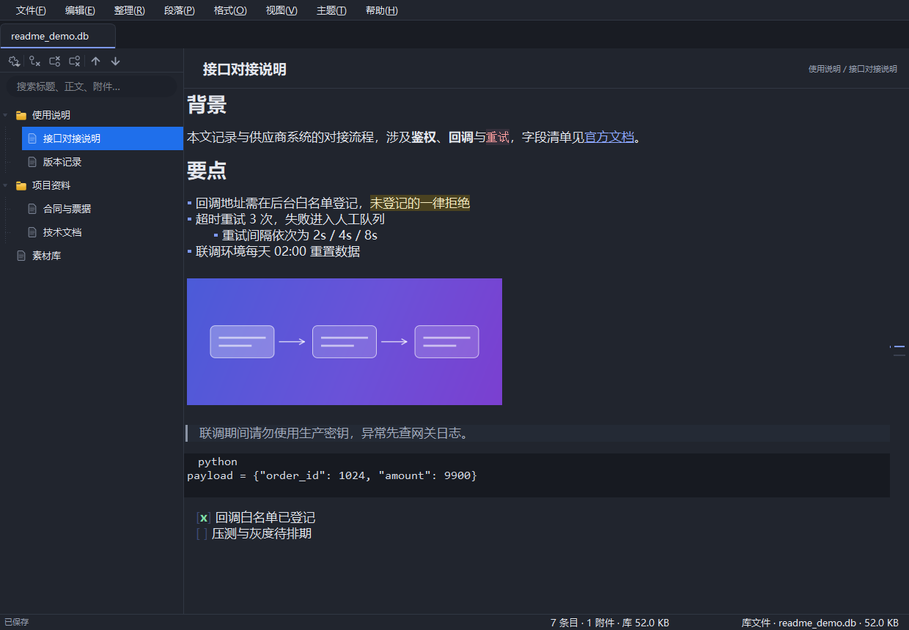

# 归藏 · 个人资料库

**把"随写随排"的 Markdown 编辑器，装进一棵能随便长的分类树，再压成一个可以拷来拷去的文件。**


整个资料库只有一个 `归藏.db`（SQLite）文件：笔记、分类、标签、附件全在里面，复制这一个文件就完成了备份与迁移。
Markdown 引擎是自研的，零第三方依赖；同一份源码跑在 Windows / macOS / Linux 上，界面与数据格式完全一致。



---

## 功能一览

| 方面 | 能力 |
| --- | --- |
| **存储** | 单文件 `归藏.db`，正文 zlib 压缩，附件按内容寻址去重 |
| **编辑** | 即时渲染 Markdown，标记符号不显示；标题 / 列表 / 引用 / 代码 / 表格 / 图片都在原位变成排版 |
| **组织** | 无限层级分类树、拖拽调整、收藏、标签、排序、自动编号、复制整枝、条目统计 |
| **检索** | 全库搜索标题 / 标签 / 正文 / 附件名，结果带命中类型与上下文摘要；单篇查找替换 |
| **外观** | 浅色 / 深色主题（含系统标题栏）、专注模式、打字机模式、缩放、全屏 |
| **迁移** | 导入文件夹或 Markdown、导出为「笔记.md + 笔记.html + 附件」、备份、精简数据库 |
| **形态** | 便携运行（库在 exe 同目录）、多库标签页、首次启动引导、跨平台 |

---

## 一、编辑：写的是 Markdown，看的是排版

编辑区只有一栏，文档自始至终是一份纯文本。渲染层只给字符加格式、画装饰，不重建文档，所以光标位置、输入法状态、撤销栈都不受影响。

- **标记不显示**：`#`、`**`、反引号、`~~`、`==`、`[](地址)`、`>`、`---`、代码围栏、表格分隔行在正文里一律不可见。
- **光标进入也不露源码**：不是"光标所在段落退回源码"的那种方案，段内编辑同样看不到符号跳动。
- **无序列表的 `-` 换成圆点**，引用左侧是画出来的竖线，代码块只留语言名标签，标题按层级给字号。
- **图片就地内嵌**：独占一行的图片在正文里直接显示（按正文宽度等比缩放，宽度不够时自动缩小），其余图片以淡色占位显示。
- **想改语法按 `Ctrl+/`**：切到源码模式看到的就是存进库里的原文，再按一次切回。

支持范围：一~六级标题（含 `{#id}`）、粗体 / 斜体 / 删除线 / `==高亮==`、行内代码、引用（可嵌套）、有序 / 无序 / 任务列表、表格（含对齐）、围栏与缩进代码块（内置多语言着色）、链接 / 图片 / 引用式链接 / 自动链接、水平分割线、Admonition、原生 HTML 透传。

常用动作都在菜单里，也都有默认快捷键：标题 `Ctrl+1`~`Ctrl+6`、段落 `Ctrl+0`、加粗 `Ctrl+B`、表格 `Ctrl+T`、代码块 `Ctrl+Shift+K`、引用 `Ctrl+Shift+Q`、任务列表与缩进各有一项。

## 二、组织：分类树与条目

- **无限层级**：节点可以一直往下建子项，拖拽即可改父子关系与顺序；右键能「上移 / 下移 / 移到顶层」。
- **收藏**：常用条目加星，树上带标记，方便回到高频笔记。
- **标签**：每条可以挂多个标签，参与搜索。
- **批量整理**：按名称 / 修改时间 / 创建时间排序子项；「自动编号」给一串子项加序号；「复制条目（分枝）」整枝带附件复制一份。
- **展开控制**：展开 / 折叠单枝、全部展开折叠、直接展开到第 N 层。
- **条目统计**：看当前条目（含子项）的条数、字数、附件数与占用。
- **多库标签页**：可以同时开多个 `归藏.db`，标签可拖动、可关闭。

## 三、检索：全库搜索与查找替换

- **全库搜索**（`Ctrl+P` 聚焦搜索框）：一次匹配**标题、标签、正文、附件名**，结果里标明命中位置，正文命中带上下文摘要，按修改时间倒序。
- **单篇查找替换**：`Ctrl+F` / `Ctrl+H`，只在当前笔记内工作。
- 正文的搜索索引用明文列，压缩只作用于存储列，所以搜索不需要解压全库。

## 四、附件与图片

- 图片、文档、压缩包都可以挂到条目上，附件**随库保存**，跟着 `归藏.db` 一起走。
- 图片可以直接拖进正文或粘贴，落库后以 `gzs://` 内嵌地址引用，不依赖外部路径。
- 附件栏可显示 / 收起（默认收起，编辑界面只留正文）；双击临时解包查看，**退出后不留痕**。
- 导出条目时附件按原名还原到 `附件/` 子目录。

## 五、外观

- **浅色 / 深色主题**：主题记在库里，多端一致；深色下系统标题栏、标签栏、滚动槽、对话框按钮区一并变暗（Win10 为纯黑标题栏，Win11 跟随面板色）。
- **专注模式**：收起分类栏与附件栏，正文独占整宽。
- **打字机模式**：光标行固定在视口中部，长文写作不用一直往下看。
- **缩放与实际大小**、**全屏**都在「视图」菜单里。



## 六、数据与迁移

- **一个文件**：所有内容在 `归藏.db` 内；`文件 → 备份资料库到文件…` 生成带时间戳的副本。
- **导入**：`文件 → 导入文件夹为分类…` 按目录结构整棵建树（文件作为附件挂上）；`导入 Markdown 文件…` 把 `.md` 变成条目。
- **导出**：`导出此条目…` 递归导出整枝，每条一个文件夹，内含 `笔记.md`（原始源码）、`笔记.html`（独立可看的渲染版）和 `附件/`。
- **精简数据库**：删除只标记空闲页，文件不会自动变小；`文件 → 精简数据库（压缩并整理）` 重建并 `VACUUM`，回收空间。
- **便携**：Windows 便携版把库放在 exe 同目录，拷到 U 盘即可换机使用。
- **版本兼容**：新版本建的库不能用旧版本打开（正文会显示空白），请保持打开库的版本 ≥ 建库版本。
- **历史格式**：旧的 `GuiZangData/` 目录存储、旧的 HTML 笔记，首次打开时会自动迁移成单文件库 + Markdown。

## 七、快捷键

全部可在「快捷键」设置里改（存进库的 `keymap`，跟着库走），`F1` 随时查看一览。常用的：

| 操作 | 键 | 操作 | 键 |
| --- | --- | --- | --- |
| 保存 | `Ctrl+S` | 新建子条目 | `Ctrl+Alt+N` |
| 新建同级条目 | `Ctrl+N` | 快速打开（搜索） | `Ctrl+P` |
| 源码 / 即时渲染切换 | `Ctrl+/` | 收藏 / 取消收藏 | `Ctrl+D` |
| 一~六级标题 | `Ctrl+1`~`Ctrl+6` | 正文段落 | `Ctrl+0` |
| 加粗 / 斜体 | `Ctrl+B` / `Ctrl+I` | 删除线 / 高亮 | `Alt+Shift+5` / `Ctrl+Shift+H` |
| 链接 / 图片 | `Ctrl+K` / `Ctrl+Shift+I` | 表格 | `Ctrl+T` |
| 代码块 / 引用 | `Ctrl+Shift+K` / `Ctrl+Shift+Q` | 查找 / 替换 | `Ctrl+F` / `Ctrl+H` |
| 专注 / 打字机 / 全屏 | `F8` / `F9` / `F11` | 附件栏 | `Ctrl+Shift+E` |

> `Delete` 删除条目**只在分类树聚焦时生效**，并且先弹确认；焦点在正文、搜索框时它只删字符。

---

## 八、下载与安装

到 [Releases](https://github.com/aliex9527/GuiZang/releases) 下载对应平台的最新版本：

| 平台 | 安装包 | 说明 |
| --- | --- | --- |
| Windows 10 / 11 · 64 位 | `GuiZang-<版本>-windows-x64.exe` | 单文件 exe，双击即用，库在同目录 |
| macOS · Intel / Apple 芯片 | `GuiZang-<版本>-x64.dmg` / `-arm64.dmg` | 拖入「应用程序」即可 |
| Linux · x64 | `GuiZang-<版本>-linux-x64.tar.gz` | 解压即用 |

当前最新版本：**v1.1.4**（Windows 便携版约 44 MB）。版本改动写在对应 Release 正文，仓库内留档于 [`docs/releases/`](docs/releases/)。

各平台的依赖与打包细节：[`README_mac.md`](README_mac.md) · [`README_linux.md`](README_linux.md) · [`README_github_actions.md`](README_github_actions.md)

## 九、快速上手

1. **首次启动**弹引导框：选择「创建数据库」（指定位置生成 `归藏.db`）或「打开已有数据库」。
2. 左侧分类树右键新建分类 / 笔记，右侧直接开始写。
3. 写 `## ` 就是二级标题，`- ` 就是列表，`**粗**` 立刻变粗——符号本身不显示。
4. 想核对原文按 `Ctrl+/` 切源码模式；`Ctrl+P` 在全库范围里找内容。
5. 备份就复制 `归藏.db`；需要结构化的副本时用「导出此条目」。

## 十、从源码运行

需要 Python ≥ 3.10，唯一必需依赖是 `PySide6-Essentials`。

```bash
git clone git@github.com:aliex9527/GuiZang.git
cd GuiZang
python -m venv .venv
source .venv/bin/activate          # Windows: .venv\Scripts\activate
pip install -r requirements.txt

python main.py                     # 启动（首次会引导建库）
python main.py --db /path/to/归藏.db   # 直接打开指定库
GUIZANG_DB=/path/to/归藏.db python main.py
```

```bash
python -m unittest discover -s tests -q     # 单元测试（引擎 / 桥接 / 渲染层）
```

### 自研引擎单独使用

`mdengine/` 是纯标准库实现，可以脱离界面直接跑：

```bash
python -m mdengine README.md -o out.html     # Markdown → HTML
python -m mdengine page.html --reverse       # HTML → Markdown
python -m mdengine --serve --open README.md  # 本地实时预览（只监听 127.0.0.1）
```

> 旧的第三方链路（`markdown` + `html2text` + `Pygments`）保留作回退：设 `GUICANG_MD_ENGINE=0` 即可切回，此时才需要装这三个包。

### 打包

| 平台 | 命令 | 产物 |
| --- | --- | --- |
| Windows | `python tools/build_win.py` | `dist/GuiZang-<版本>-windows-x64/*.exe` |
| macOS | `./build_mac.sh` | `dist/GuiZang-<版本>-<架构>.dmg` |
| Linux | `./build_linux.sh` | `dist/GuiZang-<版本>-linux-x64.tar.gz` |

PyInstaller 不能交叉编译，macOS / Linux 包需在对应系统上执行。推 `v*` tag 会触发 CI 三平台构建并发布 Release。

<details>
<summary>目录结构</summary>

```
归藏-工作区/
├── main.py                  # 入口：解析库文件、首启动引导、应用主题
├── core/
│   ├── database.py          # SQLite 封装：节点、压缩存储、搜索、迁移、精简
│   ├── storage.py           # 附件缓存与退出清理
│   ├── ui_state.py          # 窗口状态、最近库
│   └── version.py
├── mdengine/                # 自研 Markdown 引擎（零依赖）
│   ├── block.py / inline.py # 块级 / 行内解析
│   ├── render.py / nodes.py # AST → HTML
│   ├── html_to_md.py        # HTML → Markdown
│   ├── highlight.py         # 代码着色
│   ├── live.py / server.py  # 增量渲染、本地预览服务
│   └── cli.py
├── ui/
│   ├── database_view.py     # 主视图：分类树 + 编辑器 + 附件 + 菜单
│   ├── main_window.py       # 多库标签页与状态栏
│   ├── note_editor.py       # 编辑器外壳：模式切换、工具栏
│   ├── source_edit.py       # 源码编辑器：着色、列表续行、图片拖放
│   ├── live_render.py       # 就地渲染层：标记隐藏、装饰绘制
│   ├── doc_nav.py           # 右侧标题导航条
│   ├── search_panel.py / find_dialog.py
│   ├── attachments.py       # 附件面板
│   ├── keymap*.py / shortcuts_dialog.py
│   ├── theme.py / style.py / win_dark.py / fonts.py
│   └── welcome.py / msgbox.py / icons.py
├── tests/                   # 单元测试
├── tools/                   # 图标、版本、发布说明等脚本
├── docs/releases/           # 各版本说明存档
└── VERSION
```

</details>

## 十一、常见问题

- **正文里看不到 `#`、`**` 这些符号？** 默认行为——编辑区显示排版结果而非源码。要原文按 `Ctrl+/`。
- **打开旧库显示空白？** 用旧版本打开了新版建立的库。请用 ≥ 建库版本的软件打开。
- **删除内容后 `归藏.db` 不见小？** SQLite 只标记空闲页，用「精简数据库」回收。
- **深色下标题栏颜色不对？** Win10 只支持纯黑标题栏；Win11 跟随主题面板色。切主题后无需重启。
- **资料库在哪？** 便携版在 exe 同目录的 `归藏.db`；非便携版在系统用户数据目录。`文件 → 在资源管理器中显示库文件` 可直接定位。
- **Linux 报 `Could not load the Qt platform plugin "xcb"`？** 缺图形栈依赖，见 [`README_linux.md`](README_linux.md)。

## 许可证

本项目当前未附带明确开源许可证，仅供个人使用。如需分发或二次开发，请先联系作者确认授权。
